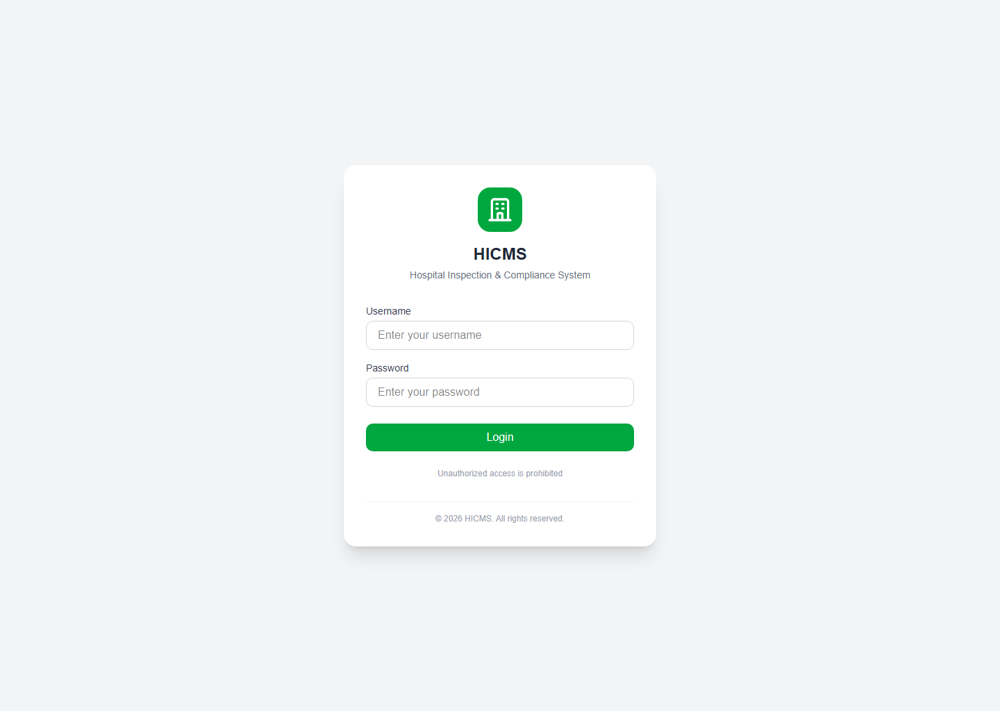

# HICMS — Hospital Inspection & Compliance System

HICMS is a full-stack web application for planning, conducting, and monitoring healthcare-facility inspections. It gives administrators, inspectors, supervisors, and facility quality-assurance teams role-specific workspaces for tracking compliance, corrective actions, inspection schedules, and reports.

## Why HICMS

Manual inspection workflows make it difficult to see inspection progress, compare facility performance, and follow up on corrective work. HICMS centralizes those workflows in one application, providing a clearer audit trail and practical dashboards for operational decision-making.

## Highlights

- Role-based access for national, regional, district, and facility administrators; inspectors; supervisors; and facility QA users.
- Inspection planning, assignment, approval, scheduling, and pre-inspection workflows.
- Standards-based compliance checklists and inspection submissions.
- Compliance dashboards, facility rankings, trend analysis, alerts, and Gantt-style scheduling views.
- Corrective-action tracking with comments and status updates.
- Facility, department, user, role, and hierarchy management.
- Downloadable and exportable inspection and compliance reports.
- Audit logging for administrative activity.

## Screenshots

### Secure login



## Technology

| Area | Tools |
| --- | --- |
| Frontend | React 19, Vite, React Router, Tailwind CSS, Recharts |
| Backend | Django 6, Django REST Framework |
| Authentication | Token authentication with role-based authorization |
| Data | SQLite for local development |
| Reporting | ReportLab, CSV and Excel export endpoints |

## Project structure

```text
HICMS-project/
├── HICMS/                 # Django project and REST API
│   ├── accounts/          # Users, roles, permissions, audit endpoints
│   ├── facilities/        # Facilities and departments
│   ├── inspections/       # Inspection, planning, checklist, and action workflows
│   ├── reports/           # Reporting and export endpoints
│   ├── standards/         # Compliance standards
│   └── hierarchy/         # National-to-facility hierarchy management
├── frontend/              # React single-page application
│   └── src/pages/         # Dashboards, inspections, reporting, and administration views
└── docs/screenshots/      # Product screenshots used in this README
```

## Run locally

### Prerequisites

- Python 3.14
- Pipenv
- Node.js 20+ and npm

### Backend

```bash
pipenv install
cd HICMS
pipenv run python manage.py migrate
pipenv run python manage.py runserver
```

The API is then available at `http://127.0.0.1:8000/`.

### Frontend

In a separate terminal:

```bash
cd frontend
npm install
npm run dev
```

Open the local address printed by Vite (normally `http://127.0.0.1:5173`).

## Recruiter notes

- Start with the dashboards to see how HICMS translates inspection data into operational summaries.
- Review `frontend/src/pages/` for the main user-facing workflows.
- Review `HICMS/inspections/` for the inspection domain model and API workflows.
- The frontend can be production-checked with `npm run build` from `frontend/`.

## Repository hygiene

Local databases, Python caches, virtual environments, frontend dependencies, and environment files are excluded from version control. Configure production secrets and allowed hosts through environment-specific settings before deployment.

## Author

[Angella Mhango](https://github.com/Angella-Mhango)
